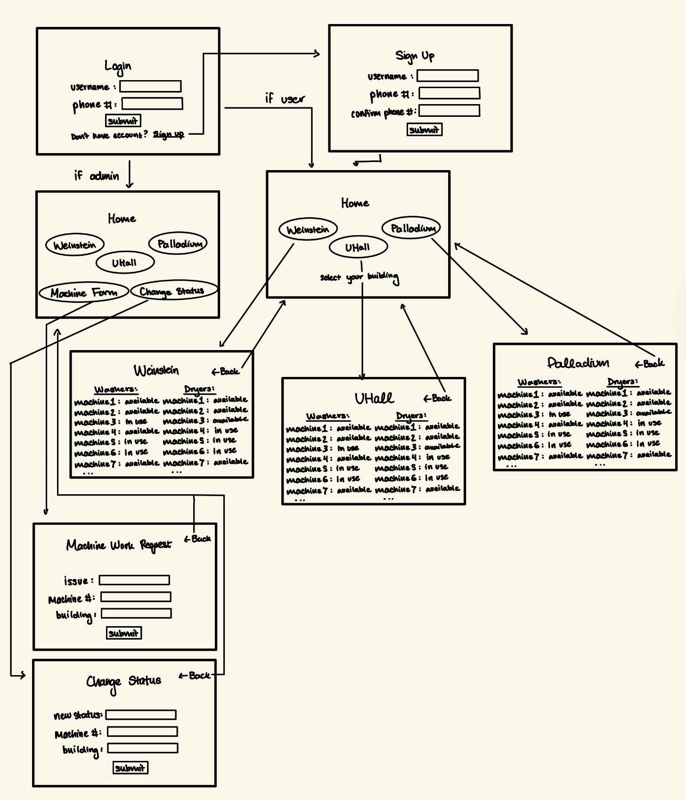

# Web Application Exercise

A little exercise to build a web application following an agile development process. See the [instructions](instructions.md) for more detail.

## Product vision statement

Our team's product is a laundry management app that enables NYU students to join digital waitlists for dorm washing machines and dryers while empowering building admins and repair technicians to streamline machine status communication.

## User Stories
User Stories: [View GitHub Issues / User Stories](https://github.com/software-students-fall2026/web-app-exercise-goobers/issues)

## Wireframes

## Steps necessary to run the software

### Prerequisites

Make sure you have the following installed on your machine:
* Python
* MongoDB
* Flask

---

### Installation & Setup

1. Clone a copy of the repository to your local machine from GitHub

2. Download the .env files shared in discord team channel

3. Copy and paste the .env file inside your copy of the repository

4. In a your terminal write python app.py and press enter

5. The in the terminal ctrl + click on the web address that appears and the web app will be useable.  

## Task boards

Sprint Task Boards: [GitHub Projects Page](https://github.com/software-students-fall2026/web-app-exercise-goobers/projects)
